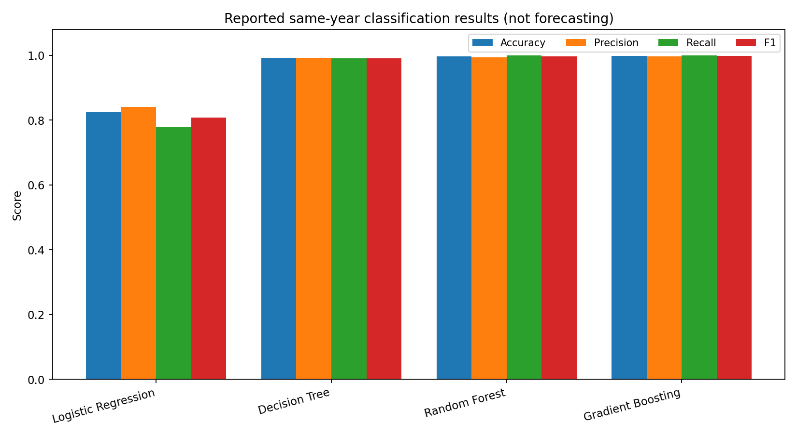

# Predicting Macroeconomic Stress Using Machine Learning

An exploratory machine-learning study of **country-year macroeconomic stress**, using World Bank World Development Indicators (WDI) accessed through Google BigQuery and analyzed in Google Colab.

**Research question:** Can economic indicators help identify macroeconomic vulnerability, and can prior-year observations predict next-year threshold-defined stress?

> **Important distinction:** The original assignment's headline results measure **same-year reconstruction of a rule-defined stress label**, not demonstrated advance prediction of future crises. The high scores are expected when model inputs include the very variables and derived indicators that determine the label. A temporally separated lagged-feature evaluation is provided as the next reproducibility step; no forward-looking scores are claimed without running it.

## Dataset and scope

| Property | Detail |
|---|---|
| Source | World Bank WDI via Google BigQuery public data; local user-created table |
| Domain | Macroeconomics, international development, risk monitoring |
| Unit | Country-year |
| Observations | 5,423 (reported in original analysis) |
| Columns | 20 (reported) |
| Period | 1995–2020 |
| Target | `economic_stress`, binary (0 no stress; 1 stress) |
| Classes | 2,838 no-stress (52.33%); 2,585 stress (47.67%) |

Original analysis defines stress as at least one of the following: negative GDP growth, inflation above 10%, unemployment above 10%, current-account balance below −5% of GDP, or exchange-rate depreciation above 20%. **Before republishing results with modified labels, verify the exact SQL label-generation logic in the BigQuery source.** Null indicators can affect label assignments.

Main indicators include GDP growth and per-capita GDP, inflation, unemployment, current account, exports/imports/trade, FDI, exchange rate, and population. Engineered indicators include misery index, trade balance proxy, growth-inflation gap, external-pressure score, and exchange-rate change.

## Reported baseline results (not forward forecasts)

| Model | Accuracy | Precision | Recall | F1 | ROC-AUC |
|---|---:|---:|---:|---:|---:|
| Logistic Regression | 0.8240 | 0.8410 | 0.7776 | 0.8080 | 0.8853 |
| Decision Tree | 0.9917 | 0.9922 | 0.9903 | 0.9913 | 0.9971 |
| Random Forest | 0.9972 | 0.9942 | 1.0000 | 0.9971 | 0.9999 |
| Gradient Boosting | **0.9982** | **0.9961** | **1.0000** | **0.9981** | **1.0000** |

These are values **transcribed from the uploaded project report**, not newly independently reproduced. See [results](docs/RESULTS.md) for confusion matrices and methodological caveats.

## Repository contents

- `notebooks/forward_warning_colab.ipynb` — clean, privacy-conscious Colab workflow using **lagged predictors and chronological holdout**.
- `notebooks/original_analysis_sanitized.ipynb` — original exploratory notebook with outputs, execution metadata, and cloud project identifiers removed; preserved for reference **not guaranteed to run sequentially**.
- `docs/DATA.md` — sources, schema, missingness, target rules.
- `docs/METHODOLOGY.md` — modeling design, validation, limitations.
- `docs/RESULTS.md` — original reported findings with appropriate qualifications.
- `docs/PRIVACY.md` — audit and public-release checklist.
- `results/` — aggregate, non-personal performance tables.

## Data sources

Public WDI indicator data have their own citation and licensing terms; cite and comply with [World Bank Open Data](https://data.worldbank.org/) and [Google Cloud BigQuery public datasets](https://cloud.google.com/bigquery/public-data).

## Limitations

Threshold-defined stress is a **research proxy**, not a verified crisis event label. The original near-perfect scores are partly due to target construction from contemporaneous features, and random splits of a country-year panel do not establish prospective forecasting skill. External validation, sensitivity analyses across thresholds, missingness auditing, and prospective country/time tests are necessary before any policy use.

## Privacy

This copy excludes identifying cover-page details, notebook cell outputs, source Cloud project identifiers, and any raw credentials. It does **not** include the original identified PDF report. Inspect [the release checklist](docs/PRIVACY.md) before pushing.

## License / citation

Code-only reuse: MIT License (see `LICENSE`). **This license does not supersede upstream WDI data terms.** Cite the World Bank World Development Indicators when using the data.
